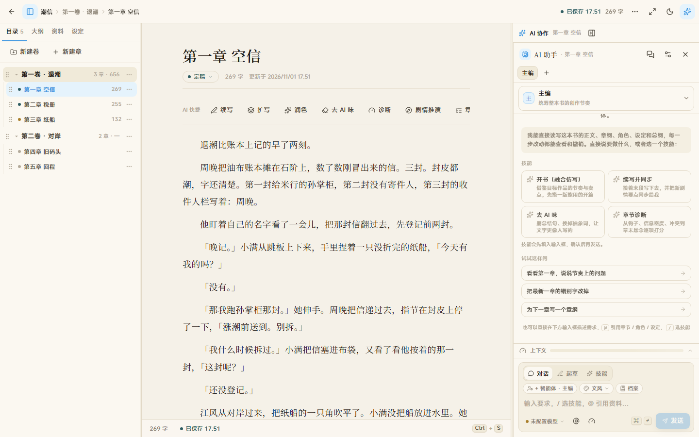
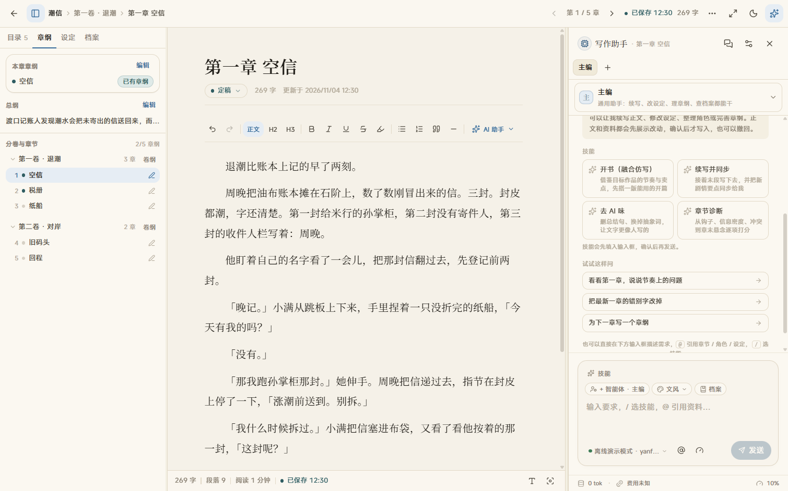
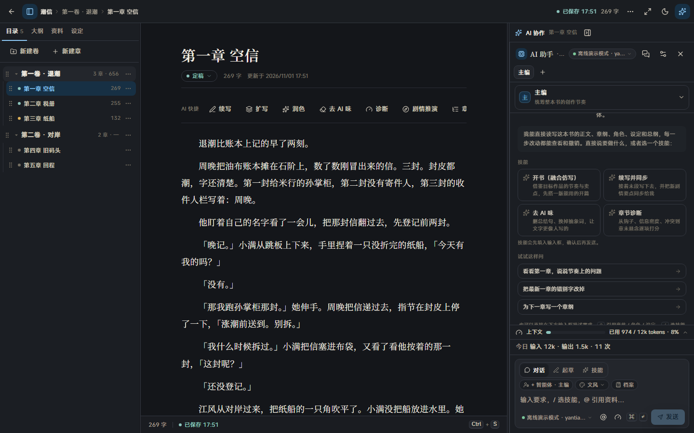
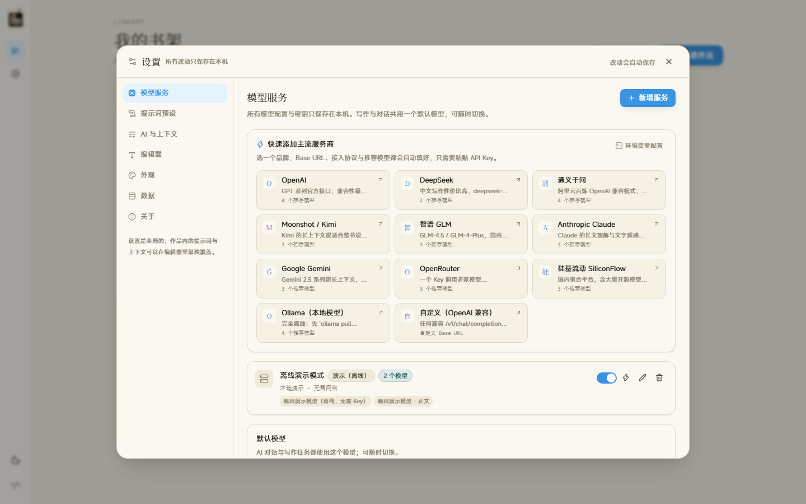

# 砚田 Yanfield

本地部署、隐私优先的长篇小说创作工作台。书稿、设定与灵感都保存在你自己的电脑或服务器上，不依赖账号和云端平台；在此基础上接入 AI，辅助大纲、写作与资料管理，每一处 AI 改动都由你点头才落笔。

[](LICENSE)
[](https://nodejs.org)
[](https://nextjs.org)
[](https://www.typescriptlang.org)
[](tests)
[](Dockerfile)

> **状态：v0.1.0 开发中，尚未发布正式版本。** 功能已能完整跑通，但接口和界面仍可能调整，欢迎试用与反馈。

## 快速开始

需要 Node.js ≥ 22.13（自带 `node:sqlite`，不用开实验标志）和 pnpm ≥ 9。不需要 Docker、MongoDB 或 Redis。

如果还没有 Node.js，先按系统安装：

- **Windows**：从 [Node.js 官网](https://nodejs.org) 下载 24 LTS 的 Windows Installer（`.msi`）并安装，保持默认选项即可。安装完成后打开 PowerShell，运行 `node --version` 和 `npm --version` 检查是否成功。
- **macOS**：从 [Node.js 官网](https://nodejs.org) 下载 24 LTS 的 macOS Installer（`.pkg`）并安装。安装完成后打开「终端」，运行 `node --version` 和 `npm --version` 检查是否成功。也可以使用 Homebrew：`brew install node@24`。

npm 会随 Node.js 一起安装，不需要单独下载。确认 npm 可用后，再安装 pnpm：

```bash
npm install --global pnpm@9
```

项目使用 pnpm 管理依赖并锁定版本；虽然 npm/yarn 在部分情况下也能安装，但不建议混用。

```bash
git clone https://github.com/ZzimaR/Yanfield.git
cd Yanfield
pnpm install
pnpm dev
```

打开 http://127.0.0.1:3000 。第一次启动会自己建数据库，并放进示例作品《潮信》，可以直接写。

接模型可以等写完再做。左下角齿轮打开设置，选 DeepSeek（或其他 OpenAI 兼容服务），粘贴 API Key 即可。也可以把 `.env.example` 复制成 `.env`，填一个 `*_API_KEY`，下次启动会自动建好服务。细节见 [docs/ai-providers.md](docs/ai-providers.md)。



## 本地部署，隐私优先

砚田首先是一个本地运行的写作工具，其次才是 AI 创作助手。你可以把它部署在自己的电脑、家庭服务器或自有 VPS 上，作品数据和配置由你自己掌控。

- 书稿、设定、AI 对话与 API Key 都保存在本地 SQLite 中，不需要注册、登录或订阅；
- 没有遥测、云同步或砚田自有服务器，只有你主动配置的模型服务会收到请求；
- 支持离线演示模式，不接入任何模型也能体验完整流程；也可以连接本机 Ollama，让内容不离开自己的设备；
- 源码公开、部署方式透明，数据文件可以自行备份、迁移和检查。

## 为什么加入 AI

写中文长篇，最难的不是写，而是「记住」：人设、设定、伏笔、前文细节、时间线，几十万字之后 AI 和作者本人都容易忘。

在本地数据掌控的前提下，砚田提供 AI 辅助：

- 不绑定模型厂商，OpenAI 兼容 / Anthropic / Gemini / Ollama 都能接，对话/大纲与正文可以分开配置模型，随时可换；
- 上下文装配是可见、可调的——哪些资料进入上下文、花多少 token，都能在设置和预览里看到；
- AI 对正文的改动一律先出**逐块 diff**，接受哪块、拒绝哪块由你决定。

## 已实现（v0.1.0 开发版）

**写作**
- 作品 / 卷 / 章三级结构，三栏沉浸写作台（目录 · 正文 · AI），自动保存、字数统计、专注模式
- 写作台左栏四页签：目录 · 章纲 · 设定 · 档案；章纲、设定、档案都在浮窗里就地编辑，不离开正文
- `Ctrl / ⌘ K` 快速跳转：搜章节、角色、设定、档案，或直接切换左栏页签；`Alt + J` 聚焦右侧 AI；`Ctrl / ⌘ + Shift + 1–4` 直达左栏四个页签；旧的大纲 / 设定 / 档案页面会自动跳回写作台
- 正文排版可调：衬线 / 黑体、字号、字重、行高、字间距、段落间距、页边距、最大行宽
- 浅色「宣纸」与深色「夜航」双主题，强调色为浅蓝；手机 / 平板响应式布局

**AI**
- 对话、起草、技能三种输入模式；主编 / 写作 / 设定 3 个内置智能体 + 可自定义人设的智能体；智能体的名称、职责、人设与额外要求可在「设置 · 智能体」里改
- `Enter` 发送、`Shift + Enter` 换行；点「技能」在输入框内展开技能清单，选中后自动填好提示词
- `@` 引用章节、角色、设定；上下文预算（默认 12000 tokens，可设为不限）与逐节预览
- 内置提示词预设：续写、扩写、润色、去 AI 味、章节诊断、章纲、人物卡、世界观卡、故事档案提取等
- 兼容 OpenAI（含 DeepSeek / 通义 / Kimi / GLM / OpenRouter / SiliconFlow 等 OpenAI 兼容服务）、Anthropic、Gemini、Ollama，以及任意自定义 OpenAI 兼容网关
- 设置页内置 11 家主流服务商预设（选品牌自动填好 Base URL 与推荐模型）；可用 API Key 从服务商**拉取真实模型列表**，也可以手动添加任意模型 id
- **双模型分工**：对话/大纲模型与正文模型分开配置，可在设置或 AI 面板里随时切换
- 也支持环境变量自动接入
- 没有 API Key 也能用「离线演示模式」走完整个流程（模板输出，不联网）

**资料与一致性**
- 三级大纲：总纲 / 卷纲 / 章纲（目标、POV、冲突、场景、钩子）
- 设定库：角色、世界观、伏笔；AI 能看到全部设定以保证前后一致，还没写到的人物与线索会标注「尚未揭示」，只用来埋伏笔；个别卡也可以关掉「AI 可见性」彻底不给 AI 读
- 故事档案：本章摘要、人物状态、设定变动、总账、时间线、待确认冲突，改章自动标记过期
- TXT 导入（正则拆章、预览后落库）、Markdown / TXT 导出

## 部署

```bash
# Docker Compose（数据持久化到 ./data；先建目录，避免容器以 root 创建后无写权限）
mkdir -p data
docker compose up -d --build

# 或 Node 直接跑
pnpm build
pnpm start
```

Windows 上如果没有符号链接权限，构建时设置 `YANFIELD_STANDALONE=0`（或使用 Docker）。systemd / VPS / 反向代理 / 备份恢复等完整说明见 [docs/deploy.md](docs/deploy.md)。

## 项目结构

```
app/          页面与 REST / SSE 路由（Next.js App Router）
components/   UI（editor / ai / cards / outline / archives / settings / landing）
lib/          领域类型、SQLite 访问、repo、AI provider / 上下文装配 / 引擎、diff
scripts/      seed、截图脚本
tests/        vitest 用例（工具函数、diff、bridge、Provider 协议、环境变量注入、资料助手、上下文披露）
docs/         功能、架构、模型服务、部署、常见问题、路线图
```

## 开发与测试

```bash
pnpm typecheck   # tsc --noEmit
pnpm test        # vitest（153 个用例）
pnpm build       # 生产构建
pnpm db:seed     # 重新生成示例作品（不删用户数据）
```

重截文档截图：`node scripts/capture-screenshots.mjs`（自动探测本机 Edge / Chrome）。

## 技术栈

Next.js 15 · React 19 · TypeScript strict · Tailwind CSS v4 · Tiptap 3 · node:sqlite · SSE 流式输出

## 截图

<table>
  <tr>
    <td align="center" width="50%">
      <br />
      <sub>首页：开始写作</sub>
    </td>
    <td align="center" width="50%">
      <br />
      <sub>三级大纲</sub>
    </td>
  </tr>
  <tr>
    <td align="center" width="50%">
      <br />
      <sub>深色「夜航」，浅蓝强调</sub>
    </td>
    <td align="center" width="50%">
      <br />
      <sub>设置悬浮窗：模型服务、11 家预设、拉取模型列表</sub>
    </td>
  </tr>
</table>

更多截图（书架、设定、故事档案、上下文预算抽屉等）见 [docs/screenshots](docs/screenshots/)。

## 文档

- [功能说明](docs/features.md)
- [架构与数据模型](docs/architecture.md)
- [模型服务与接入](docs/ai-providers.md)
- [部署指南](docs/deploy.md)
- [常见问题](docs/faq.md)
- [路线图](docs/roadmap.md)

## 路线图

- **v0.1.0（当前，开发中）**：上面列出的写作、AI、资料与一致性能力；
- **v0.2（计划）**：章节版本快照与回滚、EPUB 导出、插件机制与更多内置工作流、多人协作审校；
- **更远**：知识图谱页、爆款仿写工作台、AI 配图。

## 贡献

见 [CONTRIBUTING.md](CONTRIBUTING.md)。Issue 与 PR 都欢迎；较大的改动请先开 issue 讨论。

## 许可

[PolyForm Noncommercial 1.0.0](LICENSE)。你可以自行使用、学习、修改和分享本项目源码，但不得将本项目用于商业目的（包括部署后以任何形式向用户收费）。使用砚田创作的小说，其版权仍归作者所有。代码与界面均为独立重写；功能形态参考了中文网文写作场景中的公开产品文档，未复制任何第三方源码。
