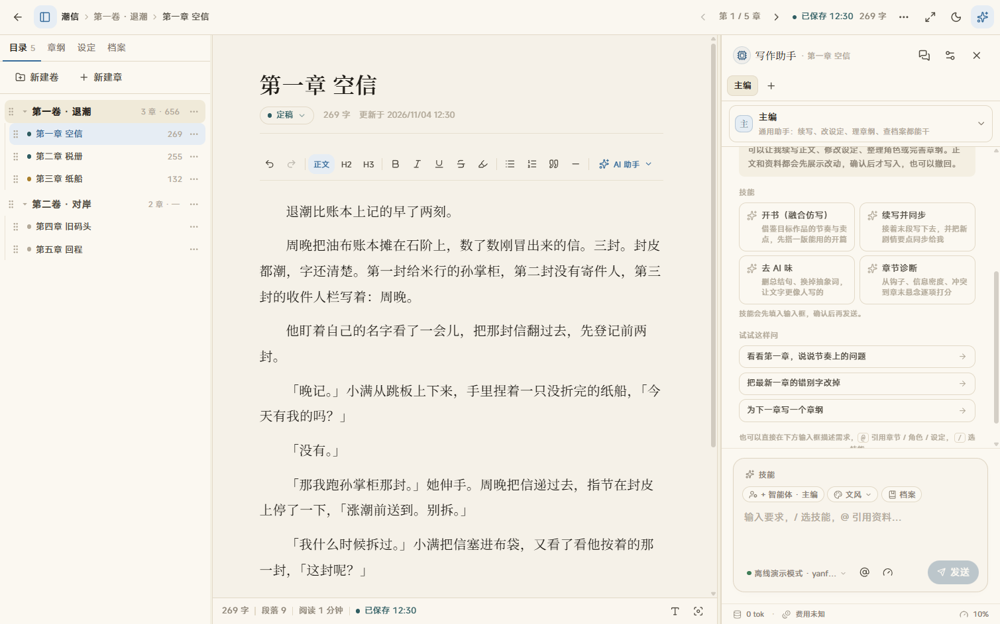
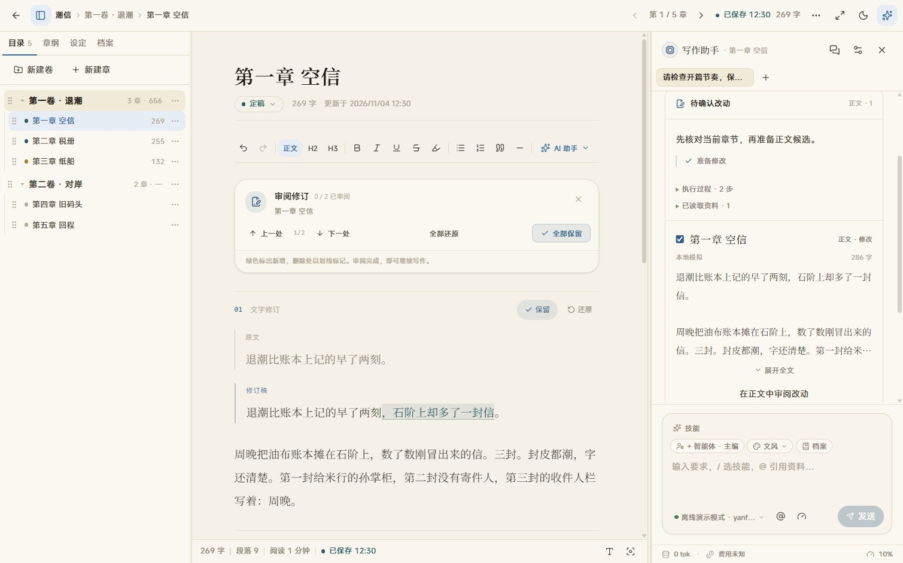

<div align="center">

<picture>
  <source media="(prefers-color-scheme: dark)" srcset="docs/assets/logo-dark.svg">
  
</picture>

# 砚田 Yanfield

**为长篇故事留一方安静的书桌。**

本地优先的小说创作工作台，让正文、设定与 AI 助手在同一处相伴。<br>
书稿由你自己保管，模型按需接入，AI 改动由你审阅。

[](#贡献)
[](https://nodejs.org)
[](Dockerfile)
[](LICENSE)

[快速开始](#快速开始) · [功能亮点](#功能亮点) · [界面截图](#截图) · [文档](#文档) · [反馈与贡献](#贡献)

</div>

> [!NOTE]
> **砚田仍在开发中，尚未发布正式版本。** 功能和界面还在持续打磨，使用时难免有不完善的地方，恳请多多包涵。
>
> 遇到 [Bug](https://github.com/ZzimaR/Yanfield/issues/new?template=bug_report.md)、有 [功能建议](https://github.com/ZzimaR/Yanfield/issues/new?template=feature_request.md)，或想分享写作体验，都欢迎通过 [Issue](https://github.com/ZzimaR/Yanfield/issues/new/choose) 告诉我们。感谢你的耐心与支持！

[](docs/screenshots/25-workspace.png)

<p align="center"><sub>三栏写作台 · 示例书稿 · 点击图片查看原图</sub></p>

## 功能亮点

| 专注写作 | 管好长篇资料 |
| --- | --- |
| 作品、分卷与章节清晰排列，自动保存、排版调整和专注模式陪你安心写作。 | 总纲、章纲、角色、设定与故事档案放在手边，方便随写随查。 |
| **AI 协作，作者做主** | **本地优先，数据自主** |
| 按需续写、改稿或整理资料；AI 提出的修改先展示，再由你决定是否采纳。 | 书稿与配置保存在自己的电脑或服务器上；可自行备份，也可选择本地模型。 |

## 快速开始

日常使用建议运行**生产模式**。需要 Git、Node.js ≥ 22.13 和 pnpm ≥ 9；不需要 Docker、MongoDB 或 Redis。

<details>
<summary>还没有安装 Node.js 或 pnpm？</summary>

- **Windows**：从 [Node.js 官网](https://nodejs.org) 下载 24 LTS 的 Windows Installer（`.msi`）并安装。打开 PowerShell，运行 `node --version` 和 `npm.cmd --version` 检查是否成功。
- **macOS**：从 [Node.js 官网](https://nodejs.org) 下载 24 LTS 的 macOS Installer（`.pkg`）并安装，或使用 Homebrew：`brew install node@24`。安装后运行 `node --version` 和 `npm --version`。
- npm 随 Node.js 一起安装。确认 npm 可用后，运行 `npm install --global pnpm@9` 安装 pnpm；Windows PowerShell 可使用 `npm.cmd install --global pnpm@9`。

项目使用 pnpm 和锁文件管理依赖，不建议混用 npm 或 yarn。Windows 使用 `npm.cmd`、`pnpm.cmd` 也可以避开 PowerShell 的脚本执行策略限制，无需修改全局策略。

</details>

### 1. 获取源码

```bash
git clone https://github.com/ZzimaR/Yanfield.git
cd Yanfield
```

### 2. 安装、构建并启动

**Windows（PowerShell）**

```powershell
pnpm.cmd install --frozen-lockfile
$env:YANFIELD_STANDALONE = "0"
$env:NEXT_TELEMETRY_DISABLED = "1"
pnpm.cmd build
pnpm.cmd start --hostname 127.0.0.1
```

**macOS / Linux**

```bash
pnpm install --frozen-lockfile
export YANFIELD_STANDALONE=0
export NEXT_TELEMETRY_DISABLED=1
pnpm build
pnpm start --hostname 127.0.0.1
```

打开 [http://127.0.0.1:3000](http://127.0.0.1:3000)。首次使用时会创建本地数据库和示例作品《潮信》。

`YANFIELD_STANDALONE=0` 使用适合本机运行的普通构建，也能避免 Windows 的符号链接权限问题；`NEXT_TELEMETRY_DISABLED=1` 关闭 Next.js 自带的匿名遥测。**每次新开终端启动时，都需要重新设置这两个变量**。

首次安装或更新代码后需要构建。日后进入 `Yanfield` 目录，重新设置变量并运行 `pnpm start --hostname 127.0.0.1`（Windows 使用 `pnpm.cmd`），不必每次重新构建。保持终端运行，按 `Ctrl + C` 停止。

`pnpm dev` 是开发调试模式，首次访问页面时可能需要即时编译；日常写作请使用上面的生产模式。上述启动命令只监听本机；砚田没有登录鉴权，不要直接暴露到公网，远程访问请参考[部署指南](docs/deploy.md)。

### 3. 按需接入 AI

不接模型也能写作。需要 AI 时，打开左下角设置，选择 DeepSeek 或其他兼容服务，填写 API Key，再拉取并选择可用模型。也可以将 `.env.example` 复制为 `.env`，填写 `*_API_KEY` 后重启；详见[模型服务与接入](docs/ai-providers.md)。多步 Agent 需要配置实际模型，离线演示模型只提供模板功能。

## 本地部署，隐私优先

砚田首先是一个本地运行的写作工具，其次才是 AI 创作助手。你可以把它部署在自己的电脑、家庭服务器或自有 VPS 上，作品数据和配置由你自己掌控。

- 书稿、设定、AI 对话与 API Key 都保存在本地 SQLite 中，不需要注册、登录或订阅；
- 砚田本身不提供用户遥测、云同步或自有服务器；上面的启动命令也关闭了 Next.js 自带的匿名遥测；
- 使用云模型时，实际请求中的书稿和上下文会发送给你配置的模型服务；也可以连接本机 Ollama，让模型请求留在自己的设备上；
- 支持离线模板演示；多步 Agent 需配置实际模型；
- 源码公开、部署方式透明，数据文件可以自行备份、迁移和检查。

## 为什么加入 AI

写中文长篇，最难的不是写，而是「记住」：人设、设定、伏笔、前文细节、时间线，几十万字之后 AI 和作者本人都容易忘。

在本地数据掌控的前提下，砚田提供 AI 辅助：

- 不绑定模型厂商，OpenAI 兼容 / Anthropic / Gemini / Ollama 都能接，助手与写作任务共用默认模型，随时可换；
- 上下文范围与预算可调，预览显示作品资料的分节和 token 估算；Agent 实际按需读取，预览不是完整请求清单；
- 助手能按需读资料、多步执行，提出正文和资料改动；正文在写作区逐处高亮审阅，资料按字段对比。新章可整篇保留，已有正文可逐处保留或还原；确认后回到普通正文继续编辑，历史对比单独查看。工具栏的「AI 助手」下拉菜单收纳快捷任务。见[正文审阅截图](docs/screenshots/22-review-light.jpg)。

## 已实现（v0.1.0 开发版）

<details>
<summary>展开查看写作、AI 和资料功能</summary>

**写作**
- 作品 / 卷 / 章三级结构，三栏沉浸写作台（目录 · 正文 · AI），自动保存、字数统计、专注模式
- 写作台左栏四页签：目录 · 章纲 · 设定 · 档案；章纲、设定、档案都在浮窗里就地编辑，不离开正文
- `Ctrl / ⌘ K` 快速跳转：搜章节、角色、设定、档案，或直接切换左栏页签；`Alt + J` 聚焦右侧 AI；`Ctrl / ⌘ + Shift + 1–4` 直达左栏四个页签；旧的大纲 / 设定 / 档案页面会自动跳回写作台
- 正文排版可调：衬线 / 黑体、字号、字重、行高、字间距、段落间距、页边距、最大行宽
- 浅色「宣纸」与深色「夜航」双主题，采用沉稳的墨蓝强调色；手机 / 平板响应式布局

**AI**
- 右侧统一 Agent 助手：续写、改稿、建卡、修改设定和整理章纲都在同一对话中执行；保留技能预设、文风选择与可自定义的人设
- 对话会用第一条提问自动命名，历史中的默认标题也会从消息中补出；空会话保留「新对话」
- `Enter` 发送、`Shift + Enter` 换行；点「技能」在输入框内展开技能清单，选中后自动填好提示词
- `@` 引用章节、角色、设定、伏笔和档案；可配置上下文预算与逐节预览
- 关键进展按顺序保留，当前步骤原地更新，正文起草显示实时预览；上翻阅读时暂停自动滚动，点「有新进展」回到底部。刷新后保留新任务的进展记录
- 运行卡片显示执行过程、引用资料、正文候选和资料改动；可选择条目或字段应用，服务端校验版本并以事务写入
- 写完正文会整理有原文依据的资料候选，匹配姓名和别名以减少重复；自动整理只补已有卡的空白，不覆盖作者事实
- 写作请求把稳定资料放在前面、当前正文与临时任务放在后面，规范序列化顺序并去掉重复正文，提高服务商前缀缓存的复用机会
- 支持普通输入、缓存命中输入、输出三档单价；消息与每日统计区分命中、未命中和未报告的输入，官方单价可一键填入三档
- 用量收进输入框底部的小状态行与消息明细图标。可识别的接口费用保留原币种；未返回费用时按配置单价明确标为预估，未设单价显示未知。今日汇总是预估，不是账户账单
- 内置提示词预设：续写、扩写、润色、去 AI 味、章节诊断、章纲、人物卡、世界观卡、故事档案提取等
- 兼容 OpenAI（含 DeepSeek / 通义 / Kimi / GLM / OpenRouter / SiliconFlow 等 OpenAI 兼容服务）、Anthropic、Gemini、Ollama，以及任意自定义 OpenAI 兼容网关
- 设置页内置 11 个服务商快捷预设（选品牌只填好 Base URL 与协议，不内置过时模型）；可从服务商**拉取模型列表**，也可以手动添加模型 ID；拉取时保存能力信息，思考档位按接口与模型适配
- **统一模型配置**：在设置或 AI 面板切换默认模型；规划、正文写作与资料整理分别调用并计入本轮用量
- 也支持环境变量自动接入
- 没有 API Key 时可使用离线模板功能；多步 Agent 需要配置实际模型，演示模型不会假装执行任务

**资料与一致性**
- 三级大纲：总纲 / 卷纲 / 章纲（目标、POV、冲突、场景、钩子）
- 设定库：角色、世界观、伏笔；卡片展示身份、性格、目标和标签，资料弹窗使用档案排版与分类页签
- 弹窗左上角只保留一个「AI 助手」入口：打开写作台助手并自动 @ 当前卡片，带上未保存草稿，不自动发送；不再为每个字段重复放 AI 按钮
- 角色与设定在揭示章节前默认隐藏，本轮明确 `@` 引用可例外读取；关闭「AI 可见性」后，即使引用也不能读取
- 故事档案：本章摘要、人物状态、设定变动、总账、时间线、待确认冲突；正文更改后标记过期，重新提取时保留人工校订内容
- TXT 导入（正则拆章、预览后落库）、Markdown / TXT 导出

</details>

## 部署

```bash
# Docker Compose（数据持久化到 ./data；先建目录，避免容器以 root 创建后无写权限）
mkdir -p data
docker compose up -d --build
```

Node 直接运行见[快速开始](#快速开始)。systemd 模板：[deploy/yanfield.service](deploy/yanfield.service)。Docker/Compose 的默认服务、镜像与容器名统一为 `yanfield`；旧部署切换方式见[部署升级说明](docs/deploy.md#从旧命名部署升级)。

systemd / VPS / 反向代理 / 备份恢复等完整说明见[部署指南](docs/deploy.md)。

## 项目结构

```
app/          页面与 REST / SSE 路由（Next.js App Router）
components/   UI（editor / ai / cards / outline / archives / settings / landing）
lib/          领域类型、SQLite 访问、repo、AI provider / 上下文装配 / 引擎、diff
scripts/      seed、截图脚本
tests/        vitest 用例（工具函数、diff、bridge、Provider 协议、环境变量注入、资料助手、上下文披露）
docs/         功能、架构、模型服务、部署、常见问题、路线图
```

## 开发与测试

```bash
pnpm dev         # 开发模式，支持热更新
pnpm typecheck   # tsc --noEmit
pnpm test        # Vitest 测试
pnpm build       # 生产构建；本机运行前按快速开始设置环境变量
```

需要新增示例作品时，可用「设置 → 数据 → 重新生成示例作品」。**谨慎使用 `pnpm db:seed`**：它会删除作者为「砚田示例」或标题为《潮信》《长夜行》的所有作品（包括同名自建作品），并删除内置提示词预设；其中的修改可能丢失。运行前请先停服并备份数据库。重启后仅当数据库没有任何作品时才自动创建示例。

当前界面截图和历史截图见 [截图说明](docs/screenshots/README.md)；旧版自动截图脚本不能可靠重现新版 Agent 与审阅流程。

## 技术栈

Next.js 15 · React 19 · TypeScript strict · Tailwind CSS v4 · Tiptap 3 · node:sqlite · SSE 流式输出

## 截图

点击图片查看原图。介绍页也可在本地 `/intro` 预览。

| 正文逐处审阅 | 随写随查章纲 |
| --- | --- |
| [](docs/screenshots/22-review-light.jpg) | [](docs/screenshots/05-outline-blue.png) |

更多界面：

- [Agent 改动回执](docs/screenshots/13-agent-workbench.jpg) · [资料编辑窗口](docs/screenshots/20-card-editor-focus.jpg)
- [故事档案与冲突提示](docs/screenshots/07-archives.png)
- [模型服务设置](docs/screenshots/10-provider-settings.png) · [上下文预览](docs/screenshots/11-context-drawer.png)
- [用量与费用来源明细](docs/screenshots/15-usage-details.jpg)
- [深色主题正文审阅](docs/screenshots/21-review-dark.jpg)
- [工具栏 AI 助手菜单](docs/screenshots/24-ai-menu.jpg)
- [资料自动 @ 引用](docs/screenshots/17-card-reference.jpg)
- [写作台功能示意图](docs/screenshots/workspace-overview.svg) · [在线介绍页](https://yanfield.com/)

界面截图使用独立示例书稿；Agent 候选与用量明细使用本地构造的模拟响应和数据，不代表真实模型效果或服务商价格。历史界面见[截图说明](docs/screenshots/README.md)。

## 文档

| 想了解什么 | 参考文档 |
| --- | --- |
| 使用与功能 | [功能说明](docs/features.md) · [常见问题](docs/faq.md) |
| 模型与 AI | [模型服务与接入](docs/ai-providers.md) · [Agent 工作流、审阅与用量](docs/agent-workflow.md) |
| 部署与规划 | [部署指南](docs/deploy.md) · [路线图](docs/roadmap.md) |
| 架构与验证 | [架构与数据模型](docs/architecture.md) · [长篇性能检查](docs/performance-audit.md) · [真实模型回归记录](docs/agent-protocol-validation.md) |

## 路线图

- **v0.1.0（当前，开发中）**：上面列出的写作、AI、资料与一致性能力；
- **v0.2（计划）**：章节版本快照与回滚、EPUB 导出、插件机制与更多内置工作流、多人协作审校；
- **更远**：知识图谱页、爆款仿写工作台、AI 配图。

## 贡献

无论是使用中遇到的 Bug、觉得不够顺手的地方，还是新的功能想法，都欢迎告诉我们。不必会写代码，你的使用反馈同样能帮助砚田变得更好。

[报告 Bug](https://github.com/ZzimaR/Yanfield/issues/new?template=bug_report.md) · [提出功能建议](https://github.com/ZzimaR/Yanfield/issues/new?template=feature_request.md) · [查看已有 Issue](https://github.com/ZzimaR/Yanfield/issues)

反馈问题时，如能附上复现步骤、运行环境和截图，会更容易定位。请先遮去 API Key、私人书稿等敏感信息；安全漏洞请通过[私密安全报告](https://github.com/ZzimaR/Yanfield/security/advisories/new)提交。

也欢迎提交 PR，开发与提交流程见[贡献指南](CONTRIBUTING.md)；较大的改动建议先开 Issue 讨论。

## 许可

[PolyForm Noncommercial 1.0.0](LICENSE)。你可以自行使用、学习、修改和分享本项目源码，但不得将本项目用于商业目的（包括部署后以任何形式向用户收费）。使用砚田创作的小说，其版权仍归作者所有。代码与界面均为独立重写；功能形态参考了中文网文写作场景中的公开产品文档，未复制任何第三方源码。
